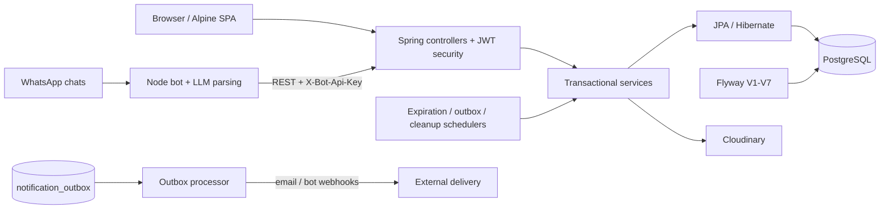

# How the database works

[Report index](README.md)

## 1. Architecture

The Kotlin/Spring backend exclusively owns PostgreSQL access. Controllers validate
DTOs and call transactional services; services use Spring Data JPA repositories;
Hibernate maps Kotlin `data class` entities onto tables. Flyway (V1–V7) owns schema
evolution and runs **before** Hibernate, which is set to `ddl-auto=validate`
(`application.properties`) — so migrations are the single runtime source of truth
and entity/schema mismatches fail startup. `open-in-view=false` and
`hibernate.jdbc.time_zone=UTC` are correctly configured. The Alpine.js frontend
and the Node WhatsApp bot reach the database only through the REST API.

## 2. Schema map

| Table | Role | Key constraints |
| --- | --- | --- |
| `users` | Accounts (pending → enabled), roles, identity lifecycle | unique `email`, unique `phone_number`, `chk_users_role`, `chk_users_version`, partial unique `uk_users_pending_email` on `lower(pending_email)` |
| `posts` | Listings with lifecycle (`ACTIVE/ARCHIVED/SOLD`) | `chk_posts_sale_state` (`status='SOLD'` ⇔ `is_sold`), `chk_posts_buyer_distinct`, `chk_posts_price/description/category/status/title_nonblank`, partial unique `uk_posts_seller_idempotency` |
| `post_media` | Ordered listing images | `uk_post_media_post_order` (post,order), `uk_post_media_one_cover` (partial), `ON DELETE CASCADE` to posts |
| `favourites` | Per-user saved listings | `uk_favourites_user_post`, cascade to users/posts |
| `sales` | One immutable transaction record per sold post | unique `post_id`, `chk_sale_distinct_users`, snapshots `title_snapshot`/`price_snapshot`, `buyer_confirmed_at` gates reviews |
| `reviews` | One review per sale per direction | `uk_review_sale_direction`, `chk_review_rating` 1–5, `chk_review_distinct_users`, `chk_review_direction` |
| `password_reset_tokens` | SHA-256 hashed single-use reset tokens | unique `token_hash`, `used` flag, expiry |
| `email_verification_tokens` | BCrypt-hashed 6-digit codes (registration + email change) | `attempts` counter, `used`, `target_email` for change flow |
| `whatsapp_login_sessions` | QR login: `session_id`/`login_token`/`claim_token` UUIDs | state CHECKs `chk_whatsapp_pending_fields` / `chk_whatsapp_completed_fields` / `chk_whatsapp_claimed_fields` |
| `notification_outbox` | Transactional outbox for email + bot messages | unique `dedupe_key`, lease (`claimed_at`, `attempts`, `next_attempt_at`) |
| `api_rate_limit_windows` | DB-backed distributed rate limiting | PK `rate_key`, fixed-minute windows |
| `migration_sale_quarantine`, `migration_review_quarantine` | V2 migration audit trail | not used by the application (F-5) |

## 3. Integrity triggers

Three `plpgsql` triggers make cross-row invariants hold even for raw SQL writers —
the strongest part of this schema:

1. **`enforce_sale_participants`** (BEFORE INSERT/UPDATE on `sales`): the sale's
   seller/buyer must match the sold post exactly (`is_sold = TRUE`).
2. **`enforce_post_sale_consistency`** (BEFORE UPDATE/DELETE on `posts`): once a
   sale row exists, the post's seller/buyer/`is_sold`/`status` can no longer
   change, and sold posts cannot be deleted while transaction history exists.
3. **`enforce_review_participants`** (BEFORE INSERT/UPDATE on `reviews`): reviewer
   and reviewee must match the sale's buyer/seller according to `direction`.

Together with `chk_posts_sale_state`, `uk_review_sale_direction`, and the sale
snapshots, this closes most of the "seller rewrites history" gaps the earlier audit
reported.

## 4. Domain flows

- **Registration → verification:** `POST /api/auth/register` creates/recycles a
  disabled user (`registration_pending=true`), stores a BCrypt-hashed code in
  `email_verification_tokens`, and enqueues an `EMAIL_VERIFICATION` outbox row
  carrying the raw code. `verify-email` consumes the code (5-attempt lockout),
  enables the user, bumps `token_version`, and issues a JWT. Email changes use
  `pending_email` + `target_email` and only swap after verification.
- **JWT auth:** tokens carry `uid` + `ver` (`token_version`); the filter reloads the
  user by id and `isTokenValid` checks uid, ver, email match, enabled state and
  expiry — so password/phone changes and anonymization revoke old tokens.
- **Listing lifecycle:** creation sets `expires_at = now + 2 days`. Every 10 min
  `PostExpirationScheduler` enqueues `BOT_RENEWAL_REMINDER` outbox rows for posts
  expiring within the hour (dedupe key + `markReminderSentIfPending` after
  delivery); every 15 min expired unsold posts are archived by a batched native
  `UPDATE ... WITH expired AS (… LIMIT 100)`. Renewal resets an archived/expiring
  unsold post to `ACTIVE`, +2 days, clears `reminder_sent_at`.
- **Sale → confirmation → review:** `mark-sold` (locked post row) flips the post to
  `SOLD` with buyer and `sold_at`, and inserts a `sales` row (snapshots). Only the
  selected buyer can set `buyer_confirmed_at`; confirmation unlocks both review
  directions (derived server-side from the sale) and enqueues the buyer review
  notification.
- **Deletion:** users with sale history are **anonymized in place** (credentials
  wiped, `token_version` bumped, synthetic email/phone); users without history are
  deleted after dependency cleanup. `BOT_ACCOUNT_DELETED` outbox rows clear
  bot-local phone state after commit.
- **WhatsApp QR login:** `session_id` (poll), `login_token` (QR/wa.me deep link),
  `claim_token` (one-time JWT exchange, 5-min TTL) with strict per-state column
  CHECKs; stale sessions are expired/deleted by `CredentialCleanupScheduler`.

## 5. Index strategy

Partial indexes mirror the hot paths: `idx_posts_public_listing` /
`idx_posts_public_category` (active unsold feed), `idx_posts_expiration_window`
(reminder scans with `reminder_sent_at IS NULL`), `idx_reviews_reviewee_direction_created_at`
(profile rating summaries), token/session lookup indexes, and
`idx_sales_buyer_confirmation`. Gaps and near-duplicates are catalogued in
[07-performance-and-indexing.md](07-performance-and-indexing.md).
