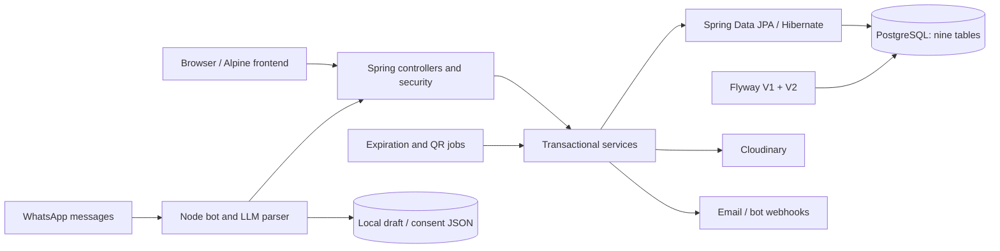
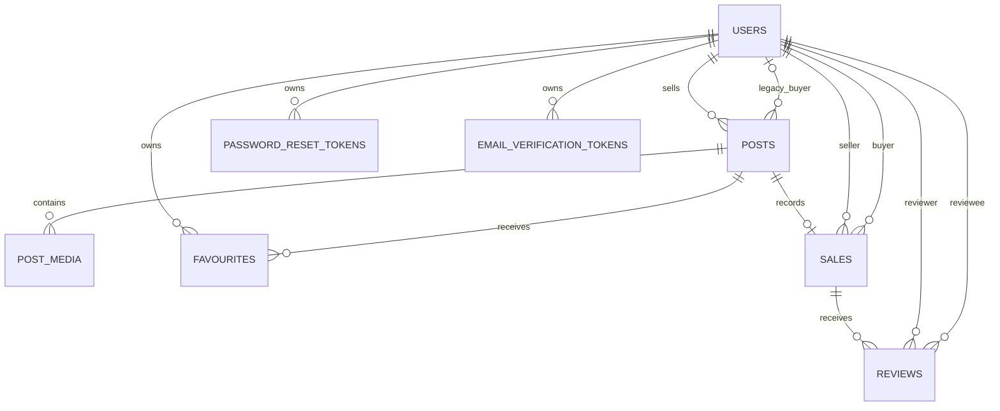

# Architecture and field inventory

[Report index](README.md)

## 1. The actual persistence architecture

The Kotlin backend owns PostgreSQL access. HTTP controllers validate DTOs and invoke Spring services. Services use Spring Data JPA repositories; most state-changing services run inside Spring transactions. Hibernate maps Kotlin entities to relational tables. Flyway runs before Hibernate's schema validation. The frontend and Node bot access the database through HTTP, not through direct SQL connections.

The diagram's bot paths describe intended routing: the reviewed bot currently crashes at module load (C01), and its phone lookup would receive 401 even after fixing that crash (C02).

### Startup and schema ownership

[src/main/resources/application.properties:9](</home/zach/Desktop/productivity/Programming/SDE Sales App/src/main/resources/application.properties:9>) configures PostgreSQL, `ddl-auto=validate`, Flyway, and automatic baselining. V1 is only a marker. V2 creates the fresh schema while also attempting to convert older `sellers`/post-based-review databases. This combines installation, transformation, and destructive cleanup in one migration. The fresh schema starts successfully; the supplied legacy schema and seed do not upgrade successfully (M01).

`validate` is useful for detecting mapping incompatibilities, but successful startup does not prove that business checks, foreign-key actions, indexes, or legacy enum values are correct. The native startup succeeded even though invalid reviews, orphan session users, and negative-price posts could be inserted directly into that schema.

### Authentication and registration

Registration creates a disabled `users` row and a BCrypt-hashed six-digit verification code. Pending registrations may be recycled by email or phone. Verification consumes the code, enables the user, and the controller returns a JWT. Email/password login uses Spring's authentication manager. Protected JWT requests instead load a user by the token's email subject and construct an authenticated principal directly. This difference causes S02.

Password resets use a random UUID whose SHA-256 hash is stored in the database. WhatsApp login uses three externally meaningful UUIDs: a polling session ID, a login token sent through WhatsApp, and a claim token exchanged for a JWT. These flows have different storage/expiry/consumption rules, with no common atomic token-consumption mechanism.

### Listing lifecycle

Creation sets `is_sold=false`, `status=ACTIVE`, and expiry roughly two days ahead. Media are inserted separately in the same database transaction, while actual image bytes live in Cloudinary. Searches select active unsold posts. Every ten minutes the reminder job selects active posts approaching expiry; every fifteen minutes another job archives expired unsold posts. Renewal permits only archived unsold posts.

Marking sold updates `posts.is_sold`, `status`, `buyer_user_id`, and `sold_at`, then inserts a unique `sales` row. Reviews use `sales`, while listing responses still read sale information from `posts`. There are therefore two competing stores of transaction facts.

### Reviews, favourites, and deletion

Each sale can have one review in each direction. The service derives participants from the sale and authenticated user; a client cannot choose an arbitrary reviewee through the request DTO. Favourites belong to the authenticated user and are unique per `(user_id, post_id)`.

Deleting a post removes favourites and reviews in application code; the fresh schema also cascades from the post to its media and sale, and from the sale to reviews. Deleting an account runs a manual dependency cleanup and removes owned posts. It clears the old buyer reference on posts but omits sales in which that user bought someone else's post (D01).

## 2. Actual relationships

`whatsapp_login_sessions.user_id` is intentionally absent from this relational diagram: the fresh migration creates a scalar ID **without a foreign key**, although the service treats it as a user reference. It needs an explicit relationship and deletion policy (D03).

## 3. Table-by-table field assessment

“Dormant” means no effective production read/write path was found in this working tree. It does not prove that deployed databases contain no historical values. Never drop a field just because this report classifies it as a cleanup candidate; profile real data and external consumers first.

### `users`

Source: [src/main/kotlin/com/studentstorefront/entity/User.kt:9](</home/zach/Desktop/productivity/Programming/SDE Sales App/src/main/kotlin/com/studentstorefront/entity/User.kt:9>), [src/main/resources/db/migration/V2__user_sales_schema_cleanup.sql:14](</home/zach/Desktop/productivity/Programming/SDE Sales App/src/main/resources/db/migration/V2__user_sales_schema_cleanup.sql:14>).

| Fields | Purpose and actual use | Assessment |
|---|---|---|
| `user_id` | Identity PK; ownership and transaction references. | Essential. Should also anchor JWT identity instead of email. |
| `name` | Public profile/listing/review labels and buyer search. | Active. Validation differs between required creation and optional updates. |
| `email` | Unique login lookup, verification/reset delivery, contact field. | Active but overloaded as a mutable identity key. Case-sensitive uniqueness; no canonicalization or verified replacement flow. |
| `phone_number` | Unique normalized `+digits`; WhatsApp account lookup and public contact. | Active, security-sensitive, but never separately ownership-verified. |
| `password` | BCrypt hash used for login and account deletion. | Essential; it is a **hash**, not reversible encryption. Avoid generated entity `toString()` disclosure. |
| `role` | `USER`/`ADMIN` authorization. | Active. Old `SELLER` values/checks are not migrated. No API supports role mass assignment. |
| `is_enabled` | Registration completion and enabled-state checks. | Active but conflates email verification and account suspension. JWT filtering ignores it. Recycling all disabled accounts is unsafe if disablement later means moderation. |
| `created_at` | Creation metadata. | Written/preserved but no main application consumer found. Reasonable audit metadata to retain, with a documented retention purpose. |

Missing concepts: verified email/phone timestamps, pending identity changes, token/session version or revoked-at state, optimistic concurrency version. These should be added only as part of explicit security workflows, not as unused columns.

### `posts`

Source: [src/main/kotlin/com/studentstorefront/entity/Post.kt:11](</home/zach/Desktop/productivity/Programming/SDE Sales App/src/main/kotlin/com/studentstorefront/entity/Post.kt:11>), [src/main/kotlin/com/studentstorefront/service/PostService.kt:175](</home/zach/Desktop/productivity/Programming/SDE Sales App/src/main/kotlin/com/studentstorefront/service/PostService.kt:175>).

| Fields | Purpose and actual use | Assessment |
|---|---|---|
| `post_id` | Listing identity and external URLs. | Essential. |
| `title`, `description`, `category` | Listing content, display, and search. | Active. Fresh schema lacks domain checks; updates can save a blank title. Category is a Kotlin enum, unconstrained text in fresh SQL. |
| `price` | Asking price, numeric(10,2). | Active. API permits excess decimal precision, then PostgreSQL rounds. Sale has no agreed-price snapshot. |
| `is_sold` | Query filters, guards, response state. | Redundant with `status=SOLD` and a sale row, but **not dead**. Remove only after all predicates/DTOs are migrated. |
| `status` | `ACTIVE`, `ARCHIVED`, `SOLD`. | Active; docs omit SOLD. It mixes listing visibility with transaction completion. |
| `created_at` | Sorting and public metadata. | Active. Several list endpoints have no deterministic default ordering. |
| `expires_at` | Reminder/archive/renewal. | Active, nullable. Null legacy values never expire; read paths do not enforce elapsed expiry directly. |
| `reminder_sent_at` | Suppresses repeated reminders. | Active but records an attempt, not confirmed delivery. |
| `sold_at`, `buyer_user_id` | Listing response and sale state. | Redundant with sale row but actively read. Can diverge from sale history. |
| `seller_user_id` | Listing owner. | Essential. Duplicated as `sales.seller_user_id`; decide whether sale seller is an immutable snapshot. |

`postMedia` is a JPA association, not another SQL column. Its inverse collection is not the primary read path: response mapping separately queries the media repository. Maintaining two access patterns causes avoidable loading and merge complexity.

### `sales`

Source: [src/main/kotlin/com/studentstorefront/entity/Sale.kt:8](</home/zach/Desktop/productivity/Programming/SDE Sales App/src/main/kotlin/com/studentstorefront/entity/Sale.kt:8>), [src/main/resources/db/migration/V2__user_sales_schema_cleanup.sql:125](</home/zach/Desktop/productivity/Programming/SDE Sales App/src/main/resources/db/migration/V2__user_sales_schema_cleanup.sql:125>).

| Fields | Purpose and actual use | Assessment |
|---|---|---|
| `id` | Review transaction identifier. | Essential; frontend review submission now uses `saleId`. |
| `post_id` | Unique FK; at most one sale per listing. | Active and correctly unique. Cascade deletion destroys history and reviews when listing is deleted. |
| `seller_user_id`, `buyer_user_id` | Review participants and pending review queries. | Active. Distinct-participant check exists, but sale seller need not equal listing owner at DB level. |
| `sold_at` | Transaction timestamp. | Written, duplicated on post; no direct application response read from Sale found. Keep the sale timestamp as canonical. |
| `created_at` | Record/import timestamp. | Written, not consumed by ordinary application logic. Not necessarily redundant with sold_at for imports/backfills; document that distinction. |

There is no sale price, currency, item snapshot, buyer confirmation, or immutable audit trail. This is a seller-reported completion record, not evidence of a payment or mutually confirmed transaction. That distinction matters for reputation integrity (D04).

### `reviews`

Source: [src/main/kotlin/com/studentstorefront/entity/Review.kt:14](</home/zach/Desktop/productivity/Programming/SDE Sales App/src/main/kotlin/com/studentstorefront/entity/Review.kt:14>), [src/main/kotlin/com/studentstorefront/service/ReviewService.kt:31](</home/zach/Desktop/productivity/Programming/SDE Sales App/src/main/kotlin/com/studentstorefront/service/ReviewService.kt:31>).

`review_id`, `sale_id`, `reviewer_user_id`, `reviewee_user_id`, `direction`, `rating`, `comment`, and `created_at` are all active. The unique `(sale_id, direction)` constraint is useful. The fresh schema nevertheless accepts rating 99, invalid direction text, and self-reviews. HTTP DTO/service rules reject ordinary invalid requests, but the database itself does not enforce these invariants.

Participants are derivable from sale plus direction, so reviewer/reviewee IDs are denormalized. They help query profiles but require enforced consistency; they should not be casually removed without redesigning those queries. Profile summaries load all matching review entities and average in Kotlin rather than aggregating in SQL (P02).

### `post_media`

Source: [src/main/kotlin/com/studentstorefront/entity/PostMedia.kt:5](</home/zach/Desktop/productivity/Programming/SDE Sales App/src/main/kotlin/com/studentstorefront/entity/PostMedia.kt:5>), [src/main/kotlin/com/studentstorefront/service/PostService.kt:269](</home/zach/Desktop/productivity/Programming/SDE Sales App/src/main/kotlin/com/studentstorefront/service/PostService.kt:269>).

| Fields | Purpose and actual use | Assessment |
|---|---|---|
| `id`, `post_id` | Media identity and owning listing. | Active. Updates delete/recreate rows rather than preserving IDs. |
| `media_url` | Displayed in browser and fetched by bot. | Active and security-sensitive. Invalid URLs are accepted at runtime; arbitrary destinations enable S06. |
| `image_hash` | Intended byte deduplication key. | **Dormant backend feature:** constructors omit it, request DTO has no hash field, resolver endpoint is absent, repository lookup has no caller. Bot's fourth argument is discarded. Historical hashes can be lost on edits. |
| `display_order` | Sort order inside listing. | Active; no fresh-schema nonnegative/unique-order check. |
| `is_cover` | Promotes primary image. | Active. Often duplicates position zero, but create-upload can choose another index; therefore not safely removable without normalization. No one-cover constraint. |

An asset table with a validated provider identity/public ID, URL, content hash, and reference lifecycle would support deduplication and safe deletion better than repeating mutable URLs. It is an architectural option, not a prerequisite for small deployments.

### `favourites`

Source: [src/main/kotlin/com/studentstorefront/entity/Favourite.kt:11](</home/zach/Desktop/productivity/Programming/SDE Sales App/src/main/kotlin/com/studentstorefront/entity/Favourite.kt:11>).

`id`, `user_id`, and `post_id` are active. `id` is a surrogate internal key; the logical key is `(user_id,post_id)` and has a unique constraint. A composite key could save an index but complicates JPA for limited benefit: this is not a priority removal. `created_at` is written but not used to sort or return favourite dates; retain for a planned “recently saved” feature or remove deliberately. No entire favourite table is dead.

### `password_reset_tokens`

Source: [src/main/kotlin/com/studentstorefront/entity/PasswordResetToken.kt:8](</home/zach/Desktop/productivity/Programming/SDE Sales App/src/main/kotlin/com/studentstorefront/entity/PasswordResetToken.kt:8>), [src/main/kotlin/com/studentstorefront/service/PasswordResetService.kt:26](</home/zach/Desktop/productivity/Programming/SDE Sales App/src/main/kotlin/com/studentstorefront/service/PasswordResetService.kt:26>).

`id`, `token_hash`, `user_id`, `expires_at`, and `used` participate in reset behavior. `created_at` is metadata without a main reader. SHA-256 storage of a random high-entropy UUID is appropriate; copying the old docs' plaintext token design would regress security. There is no unique per-user active-token constraint, atomic consumption, or independent cleanup job. Expired-token deletion runs only after a successful reset.

### `email_verification_tokens`

Source: [src/main/kotlin/com/studentstorefront/entity/EmailVerificationToken.kt:9](</home/zach/Desktop/productivity/Programming/SDE Sales App/src/main/kotlin/com/studentstorefront/entity/EmailVerificationToken.kt:9>), [src/main/kotlin/com/studentstorefront/service/EmailVerificationService.kt:34](</home/zach/Desktop/productivity/Programming/SDE Sales App/src/main/kotlin/com/studentstorefront/service/EmailVerificationService.kt:34>).

All fields have a role: `id`, BCrypt `code_hash`, `user_id`, `expires_at`, `used`, and `created_at` (latest-code ordering). Unlike other metadata timestamps, `created_at` here is queried. Missing per-code attempt counters/lockout are significant because codes have only 900,000 possible values. Tokens identify a user row, not a particular pending email change; identity mutation and code consumption must be designed together.

### `whatsapp_login_sessions`

Source: [src/main/kotlin/com/studentstorefront/entity/WhatsAppLoginSession.kt:10](</home/zach/Desktop/productivity/Programming/SDE Sales App/src/main/kotlin/com/studentstorefront/entity/WhatsAppLoginSession.kt:10>).

| Fields | Purpose and actual use | Assessment |
|---|---|---|
| `id` | Internal primary key. | Active in persistence; no independent external use found. Could be combined with session_id, but keeping internal and bearer identifiers separate is reasonable. |
| `session_id` | Frontend polling bearer identifier. | Active and effectively a credential: polling discloses claim_token. Must not be logged or treated as public metadata. |
| `login_token` | QR/WhatsApp confirmation secret. | Active; distinct purpose from session_id. |
| `claim_token` | JWT exchange credential. | Active, plaintext UUID stored; unique does not mean atomically one-use. |
| `status` | Flow state. | Active, but stale completed sessions never transition to expired in cleanup. |
| `user_id` | Confirmed user reference. | Active scalar lacking FK. |
| `phone_number` | Confirmation/failure metadata. | Written, no later decision/read found. Retain only with retention purpose; not an authorization substitute. |
| `creator_ip` | Creator metadata. | Written, never used for claim/poll binding; proxy handling differs from the limiter. Do not describe it as a security control. |
| `created_at` | Metadata. | Written, not used for expiry calculation after creation or cleanup. |
| `expires_at` | Confirmation deadline. | Active. |
| `completed_at` | Starts five-minute claim deadline. | Active and distinct from creation expiry. |
| `claimed_at` | Consumption metadata. | Written, not used to reject reuse; status is checked instead. |

The different deadlines can legitimately allow a near-expiry confirmation another five minutes to claim. The defect is inconsistent polling/cleanup and non-atomic consumption, not simply the existence of two deadlines.

## 4. Documentation is not an alternative canonical schema

[docs/database/schema.sql:3](</home/zach/Desktop/productivity/Programming/SDE Sales App/docs/database/schema.sql:3>), [docs/database/schema.dbml:1](</home/zach/Desktop/productivity/Programming/SDE Sales App/docs/database/schema.dbml:1>), and the seed/query pack still describe `sellers`, role `SELLER`, post-linked reviews, and plaintext token/code columns. Runtime has `users`, role `USER`, `sales`, sale-linked reviews, and hashed token/code columns. SQL docs contain checks and indexes missing from the runtime migration; existing tables retain those old checks/actions if V2 only uses `CREATE TABLE IF NOT EXISTS`.

Consequently, running the docs and running Flyway are not equivalent ways to initialize the application. Generate documentation and fixtures from the migrated schema, with an automated comparison in CI. The seed is a deterministic historical fixture, not a present-day expiring marketplace dataset: its May 2026 timestamps should remain pinned for query exercises but be generated relative to an injected clock for a live demo.
